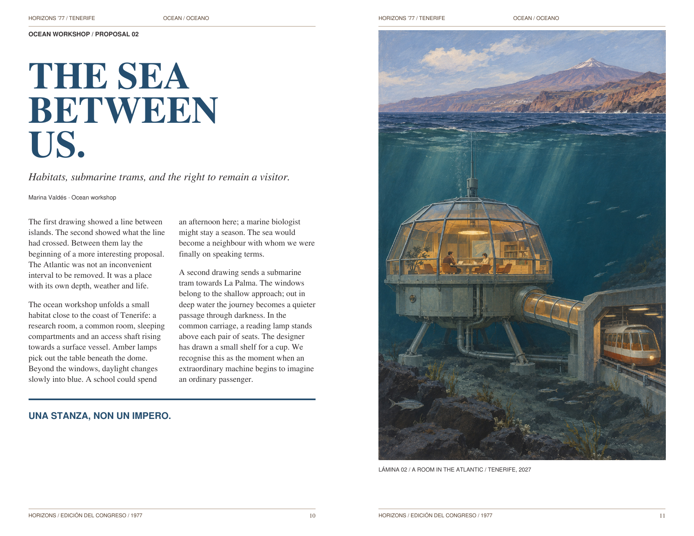
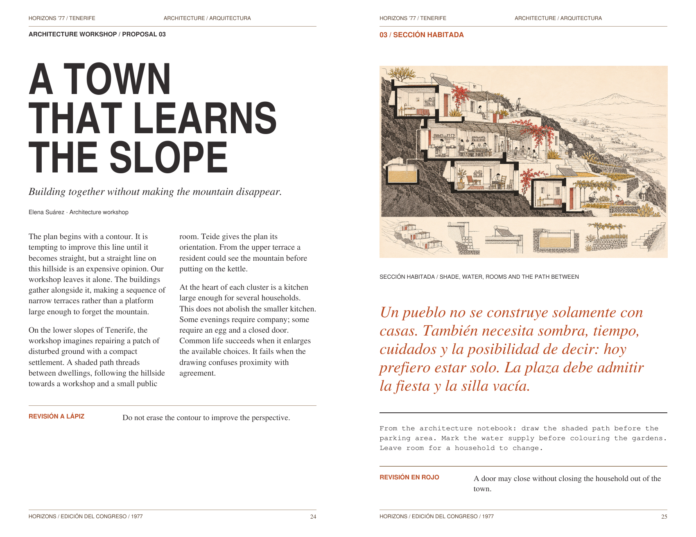
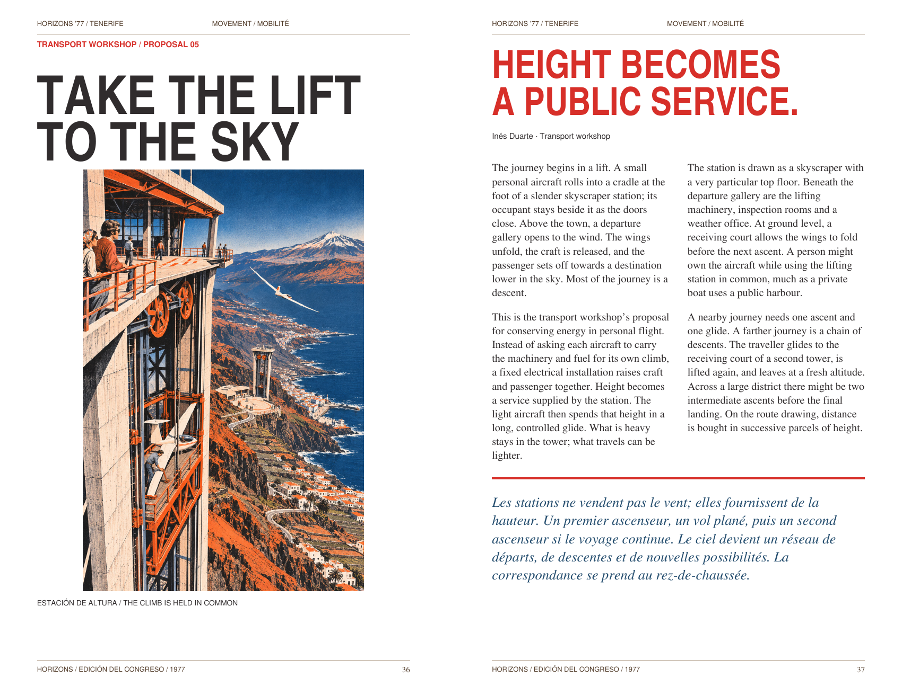

# Three proposals become pictures again

20 November 2026. Anselm's ten printed copies made clear that text completeness and efficient pagination had displaced much of the original visual ambition. This pass restores three features while preserving the richer writing and the friendships that became the book's emotional centre.

Current guidance: [editorial and design compass](../20261120-editorial-and-design-compass.md). Its emotional source is [Anselm's note on the dreamers](../20261120-the-dreamers.md). These supersede a fixed 48-page target and a uniform illustration-above-text template. The rest of the issue remains available for later design work.

The digest now has 56 interior pages. Ocean pp. 10–13, hillside pp. 24–27 and flight pp. 36–39 each occupy two real facing spreads. Full-size serif, condensed industrial and italic voices work alongside distinct new painted, sectional and poster-like illustrations. The original primary ocean schematic is superseded in the digest by the full-page proposition; its service section remains. All source assets are retained. The personal stories, poems, languages and paired friendships remain. Clarke enters in a short invented between-sessions encounter, with his 1977 collection as a historical anchor and explicit provenance at the end.

## Production decisions

Shared editorial material and web compositions: `magazine-features.js`. Physical-point composition: `print/digest-features.py`. The rest of the digest still adapts the Letter builder; this pass preserves its old size choices by logical page mapping rather than allowing inserted pages to change typography elsewhere. The feature bodies use fixed 9.4/12.2 pt text with measured column splitting. Page count may grow; type is not reduced to satisfy the old order.

The existing 48-page wrap is preserved as `Horizons-77-digest-cover-48pp.pdf`. It is not the cover for the revised body. A new printer-calculated spine is required. The 60-page whole-book proof uses the old front/back designs as separate pages and keeps the inside covers blank. A new facing-spread review PDF exposes the actual binding pairs. No print order was submitted.

The three new assets were generated with the built-in image tool. Exact [prompts](art-prompts.json) are preserved. All typography is actual embedded type, not generated image lettering. The ocean plate is approximately 225 pixels per printed inch, the hillside 338, and flight 299; no nominal resolution upscaling was used. A physical proof remains the next useful check, particularly shadow detail on uncoated paper.

## Evidence

- 56 interior pages, 60 reading-proof pages, correct 5.5 × 8.5 trim and 0.125-inch bleed.
- All 198 checked article/essay/desk paragraphs, including the four new Clarke paragraphs, found in extracted PDF text.
- All existing reading panels retained; the Machado panel now has an explicit page composition.
- All 56 pages rendered and inspected in two contact sheets; the three opening spreads inspected at larger size.
- No overlapping measured elements in the new compositions; no characters outside the checked page-safe area.
- Web: 59 folios, all numbered links resolve, three distinct loaded plates; desktop and 390-pixel layouts checked with no horizontal overflow.
- The earlier Letter files remain the previous edition, not an equivalent export of this redesign.

Next: print the six opening pages at 100%, review tone and type on the intended stock, then choose the next feature to give its own composition. New historical proceedings should be recorded as specific visual evidence before another global typography change.
